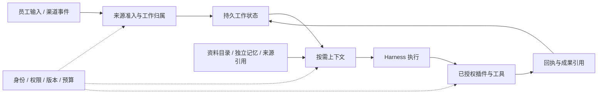

# 同舟 · Tongzhou Agent Framework

**让员工与各自的 Agent 在共同规则下协作，让工作、必要信息和经过验证的经验能够持续流转。**

同舟是面向企业内部的通用 Agent 协作框架。员工在公司版 Harness 中使用自己的岗位 Agent；公司宿主统一管理员工身份、授权、工作状态、插件、独立记忆、资料来源、日志和模型用量。具体业务通过插件与连接器接入。

[为什么做同舟](docs/WHY_TONGZHOU.md) · [0.8 Windows 体验包](https://github.com/Yyyy614/tongzhou-agent-framework/releases/tag/v0.8.0-preview.1) · [0.8 验证与边界](docs/V08_DELIVERY.md) · [接入契约](docs/CONTEXT_CONTRACTS.md) · [文档目录](docs/README.md)

## 为什么做这个框架

员工用 AI 写作、查资料、处理文件，可以提高个人效率。当工作跨过两个人或两个部门，还需要有人解释背景、确认进度、整理汇报和完成交接。

同舟希望把这些协作关系纳入框架：一件工作有持续存在的身份、明确的负责人、可查的状态和成果；Agent 在授权范围内执行，并留下下一位负责人能够接续的依据。管理者可以按权限查看进展，员工的方法也能经过验证和审核，成为可复用的组织能力。

框架面向不同业务使用。部门名称、业务字段和流程规则由能力包、预设及外部系统提供，内核负责共同的工作与可信边界。文档核对、库存比对等只是独立验证插件。

关于分工、能力封装、主动辅助和按需记忆的完整思考，见第一人称文章[《当每个员工都有自己的 Agent，公司该怎样协作？》](docs/WHY_TONGZHOU.md)。

## 一次协作怎样运行

1. 员工输入或渠道事件进入宿主，验证身份、来源和当前权限。
2. 根据明确选择、话题、回复或配置的可信对象，找到所属工作；关联不清楚时等待确认。
3. 恢复这项工作的目标、决定、阻塞和下一步，在授权资料域中按需召回必要片段。
4. Harness 使用本轮上下文和已授权工具执行；宿主检查动作、预算、版本及停止条件。
5. 宿主保存动作回执、结果和证据引用，更新工作状态；工作笔记通过显式保存或受控整理更新。
6. 按接收者权限交接或汇总；需要人工核对、审批或处理异常时保留明确等待状态。



在协作工作中，Work 是持续存在的工作事项，Task/Run 记录派工与执行，Session 承载交互。换会话不应丢失工作状态；模型说“已完成”也不直接改变审批或验收事实。

## 内核、Harness 与插件各负责什么

| 部分 | 职责 |
| --- | --- |
| 公司宿主 | 身份、组织授权、工作状态、来源约束、预算、审计和发布规则 |
| DeepSeek Harness | 模型执行循环、原生交互、岗位预设与公司扩展 |
| 业务插件与连接器 | 工具逻辑、外部系统接口、渠道适配和业务能力 |
| 资料与记忆服务 | 版本化内容、可见目录、索引、有限片段、历史与授权续读 |
| 管理后台 | 员工与岗位配置、能力审核、事件确认、上下文说明、日志和用量 |

岗位员工、团队负责人、跨团队统筹是参考预设；公司可组合出自己的岗位。组织上下级决定责任和授权，具体工作可以跨部门协作。读取资料不需要逐层唤醒负责人模型。

管理员管理权限，上级查看工作进展，均按具体授权处理。员工私人记忆不会因组织上下级关系自动公开。插件声明、Skill 文本、模型报告和 Markdown frontmatter 都不能授予权限。

## 当前可用能力

当前为 **0.8.0 隔离预览版**；框架 ABI **0.1**、插件清单 **0.1/0.2**、通信协议 **1.0** 分别管理。

| 模块 | 已实现机制 |
| --- | --- |
| 员工与岗位 | 公司账号、设备登录、部门上下级、岗位预设、显式团队授权 |
| 原生员工入口 | Harness 内登录、换岗、对话、工作中心及资料依据查看 |
| 能力管理 | 标准清单、Schema 校验、精确版本挂载、权限申请与执行检查 |
| 内部市场 | 员工贡献 Skill/插件、候选检查、独立审核、限定范围发布、安装及停用 |
| 持续工作 | 队列、跨 Agent 派工、多轮输入、人工核对、停止/等待、显式恢复及未知结果核实 |
| 事件归属 | 会话与话题分离、回复关系、可信对象关联、冲突待确认、人工纠正和持久去重 |
| 按需上下文 | 授权资料域、检索与分页、相关片段、读取预算、实际模型请求来源记录 |
| 独立与工作记忆 | 岗位笔记、目标/决定/阻塞/下一步、修订历史、条目归档、来源集合及撤权复验 |
| 分级回传 | 宿主控制事实、成果引用、受众过滤和按接收者可见资料整理的进展 |
| 模型与计量 | 公司渠道与密钥池、并发/额度控制、员工/岗位/工作用量、本地处理与模型调用分项 |
| 接入与部署 | CLI、钉钉/企微/飞书适配契约，以及云端/内网部署配置；真实目标环境需分别验收 |

具体交付和验证范围见[0.8 记录](docs/V08_DELIVERY.md)。真实企业平台收发、第二台物理电脑和生产负载尚未完成验收。

## 记忆怎样保持独立、有限和可追溯

资料按责任域组织，可覆盖公司共享知识、部门、项目、工作及个人空间。内容类别、访问范围和有效版本分别管理。

查询优先使用明确的工作或资源引用；归属不明时，从可见目录定位相关域，取得有限片段。每一步都检查权限与版本，结果说明覆盖缺口和继续读取的入口。

当前工作记忆保存目标、关键决定、阻塞、下一步及成果引用。历史来源放在版本化集合中，笔记保留集合引用，历史正文不会整批进入模型。摘要与成果继续继承真实来源约束；填写公开引用不能洗掉私有输入。

保存、索引登记、通知投递、注入模型上下文分别处理。公司服务器可以保存过程资料，上层通常只取得必要状态和授权成果引用，需要时再展开。

来源集合当前同步核验上限为一万个节点或来源，超限保持待核实。检索目前采用确定规则、词条和原库查询；模糊表达与复杂资料下的召回质量仍需评测。[完整契约](docs/CONTEXT_CONTRACTS.md)

## 本机体验 0.8

Windows 预览包包含桌面与 Node 运行时，提供安装向导和完整便携 ZIP。员工登录、岗位选择和工作中心都在 Harness 内。

**预览包默认连接本机 `http://127.0.0.1:55081`，需要先启动配套宿主。** 下载不提供公共员工账号；另一台电脑需要管理员部署可访问的同版本服务。

员工只需要安装桌面客户端；以下源码、数据库和宿主步骤由管理员或开发者完成。自己做本机体验时，需要同时准备宿主与客户端。

### 1. 准备源码与开发环境

需要 Node.js **24.9+**、Git 和专用 PostgreSQL。以下命令以 Windows PowerShell 7 为例：

```powershell
git clone https://github.com/Yyyy614/tongzhou-agent-framework.git
cd tongzhou-agent-framework
node scripts/bootstrap-deps.mjs

# 需要 PostgreSQL 的 initdb、pg_ctl 位于 PATH 中
# 也可在当前终端设置 DATABASE_URL，指向已有的专用开发数据库
node scripts/local-postgres.mjs

if (-not (Test-Path .env)) { Copy-Item .env.example .env }
# 在本机 .env 配置模型渠道；该文件不提交、不分发

npm run check
npm run build
node --env-file=.env scripts/start-v08-isolated.mjs
```

宿主仅监听本机，使用 `.local/v08/host` 对应的隔离 root/schema，保留旧版数据。它初始化合成测试员工和岗位，用通用插件验证框架。

后台地址为 `http://127.0.0.1:55081/console`。管理员凭证和测试员工账号保存在本机 `.local/v08/` 下的私有文件，具体见[体验步骤](docs/WINDOWS_V08_PREVIEW.md)。不要用生产数据库进行试运行。

没有真实模型凭证也可做确定性验证；真实 Agent 对话需要有效模型服务。

### 2. 安装员工端并登录

从 [0.8 Release](https://github.com/Yyyy614/tongzhou-agent-framework/releases/tag/v0.8.0-preview.1) 下载安装向导或便携包。便携包必须完整解压，再运行“同舟.exe”。

使用本机测试宿主生成的员工账号登录，选择岗位，在“工作依据与记忆”里查看工作、历史与来源。0.8 使用独立安装和设备命名空间，不覆盖旧版身份。

其他部署的员工端需要配置公开的服务地址，并由对应宿主创建员工账号。模型 Key 及管理员凭证不写进客户端配置。[跨电脑与私有部署说明](docs/WINDOWS_V08_PREVIEW.md)

普通开发宿主的 4317 入口、早期 4917 工作台和源码构建桌面的步骤，分别见[快速开始](docs/QUICKSTART.md)与[构建文档](docs/BUILD_AND_DISTRIBUTION.md)，它们与 0.8 隔离体验入口分别使用。

## 扩展自己的业务

统一接入以版本化清单、数据契约和宿主授权为基础。不同对象采用对应适配方式：

| 对象 | 接入方式 |
| --- | --- |
| 工具能力 | `agent-plugin.json`、输入/输出 Schema、执行协议与精确版本绑定 |
| Skill 与岗位方法 | 内容包、适用范围、审核发布与获准岗位安装 |
| 岗位 Agent | 预设、说明、允许能力、独立记忆及员工归属 |
| 资料模块 | `MemorySource` 检索/读取/版本接口，登记标准资源与权威版本 |
| 事件或消息入口 | 认证来源、身份映射、事件契约和可靠工作关联 |

MCP 服务、Harness 原生 bundle 与同舟工具包各有格式，通过适配进入宿主的权限和工作体系。外部资料源需登记标准资源，当前不能把任意 URL 或文件夹直接视为完成接入。

创建和检查工具包：

```powershell
node scripts/create-plugin.mjs ../my-capability --id @my-company/example
# 实现独立逻辑与输入/输出 Schema
node scripts/check-plugin.mjs ../my-capability
```

安装、挂载、授予权限和开启自动触发分别管理。个人调整可以积累为候选经验；共享给其他岗位前，要经过验证说明、独立审核和范围发布。更新保留版本与回退依据。

参见[插件接入标准](docs/INTEGRATION_STANDARD.md)、[协议](docs/PROTOCOL.md)、[资料与上下文契约](docs/CONTEXT_CONTRACTS.md)、[内部市场](docs/INTERNAL_MARKET_AND_EVENTS.md)，以及 `fixtures/conformance-plugin`、`examples/plugins/`、`examples/sources/`。

## 云端与公司内网

宿主、数据库和资料可以部署到公司管理的服务器。员工端连接公司服务，沿用同一套身份、资料权限、工作和来源规则。

数据持久保存在公司主机时，外部模型仍会收到本轮推理必要的上下文。完全离线需要另行部署内网模型和所需工具服务。终端也可能保留自己的聊天缓存与工作文件。

仓库提供[私有部署配置与预检说明](docs/PRIVATE_DEPLOYMENT.md)；目标硬件的容器运行、备份恢复、旧库迁移和并发负载需在实际环境验证。截至 2026-11-17，本项目的服务器测试部署已停用，数据保留，不提供在线测试地址；其他线上业务未改。公开源码和下载包继续可用，默认按上述本机方式体验。

## 验证与当前边界

```powershell
npm run check
npm test
npm run build
```

`pnpm check/test/build` 对应相同脚本。完整测试需要专用 PostgreSQL；杀进程恢复类测试要求回环地址。测试不会自动加载 `.env`，数据库配置方式见[快速开始](docs/QUICKSTART.md)。

0.8 冻结代码已通过 **104 个测试文件、223 项测试**。长期记忆合成验证包含 1001 次笔记保存、5 次受控模型请求，验证历史增长时当前输入保持有限。真实模型与桌面验证另列在[交付记录](docs/V08_DELIVERY.md)，不能将替身结果视为真实平台收发或生产承载证明。

当前需要了解的限制：

- 单项工作最多续接 32 轮，续接不能扩大创建时的参与岗位集合。
- 来源核验与上下文读取均有上限，未知或超限时受限处理。
- 缺少可靠关联的普通消息进入待确认；复杂中文、同义表达及多源召回仍需质量评测。
- 任意不可信代码的系统级沙箱、签名和统一自动升级尚未完成。
- 第二台物理电脑、真实企业机器人收发、旧业务库迁移与生产并发仍需分别验收。
- 仓库不含模型 Key、员工身份、数据库、真实日志或公司私有能力包；公开预览包也不附带它们。

## 参考与思路来源

| 来源 | 同舟的使用方式 |
| --- | --- |
| [DeepSeek Harness](https://github.com/deepseek-ai/deepseek-harness) | SDK、运行适配及原生桌面扩展的上游基础；借鉴插件化组织能力的方式 |
| [Super-agent 设计文章](https://mp.weixin.qq.com/s/zoS7GlReWPhfCjENGxXCdg) | 事件驱动、分工执行、上下文按需找回等架构启发；企业授权和工作治理由同舟补充 |
| [Anthropic 上下文工程文章](https://www.anthropic.com/research/effective-context-engineering-for-ai-agents) | 即时检索与渐进展开的设计参考，具体实现服从同舟资料契约 |
| [MCP 官方架构](https://modelcontextprotocol.io/docs/learn/architecture) | 外部工具及资料交换的协议参考；组织工作与权限由宿主承担 |

Super-agent 公众号文章是设计参考，不是本项目已接入的运行依赖或验收依据；链接可能需要在微信中打开。

项目理念来自作者对公司 AI 化、组织分工、协作成本和能力复用的思考，完整论述见[为什么做同舟](docs/WHY_TONGZHOU.md)。文中的 AtoA/A2A 泛指受管 Agent 协作，当前没有声明兼容某个同名外部协议。

同舟是独立项目。原创内容采用 [MIT 许可证](LICENSE)，第三方代码保留各自的许可和归属；详见[第三方说明](THIRD_PARTY_NOTICES.md)。

## 文档与参与

| 需要了解的内容 | 入口 |
| --- | --- |
| 理念与项目介绍 | [为什么做同舟](docs/WHY_TONGZHOU.md) |
| 当前交付、验证与限制 | [0.8 交付记录](docs/V08_DELIVERY.md) |
| 员工安装与本机体验 | [Windows 0.8 预览](docs/WINDOWS_V08_PREVIEW.md) |
| 数据与模块责任 | [总体设计](docs/FRAMEWORK_DESIGN.md)、[架构概览](docs/ARCHITECTURE.md) |
| 工作连续性与控制 | [工作连续性](docs/WORK_CONTINUITY_A1.md)、[停止与恢复](docs/WORK_CONTROL_A2.md) |
| 外部系统和企业消息 | [接入标准](docs/INTEGRATION_STANDARD.md)、[外部入口](docs/ENTRY_CONNECTORS.md) |
| 更多文档 | [文档目录](docs/README.md) |

欢迎通过 [Issue](https://github.com/Yyyy614/tongzhou-agent-framework/issues) 提供可复现的问题、资料召回评测和真实协作反馈。提交前去除员工、客户及凭证内容；贡献方式见 [CONTRIBUTING](CONTRIBUTING.md)，安全问题见[私密报告说明](SECURITY.md)。
