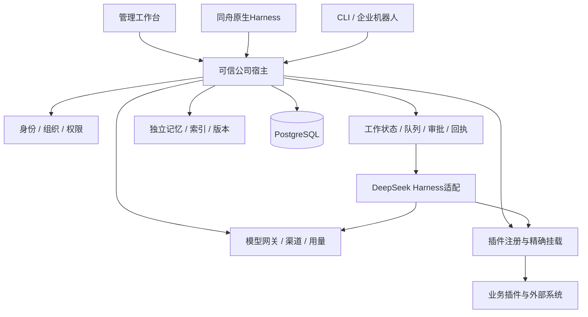

# 同舟 · Tongzhou Agent Framework

面向企业内部协作的通用 Agent 框架：统一管理员工身份、岗位、权限、插件、独立记忆、工作执行、日志与模型用量。

业务能力放在插件和连接器中，内核负责可信边界。DeepSeek Harness 提供 Agent 运行和原生交互；公司账号、组织权限与数据归属由框架宿主管理。

当前为开发测试版本：框架 ABI **0.1**，插件清单 **0.1/0.2**，通信协议 **1.0**，公司版桌面测试发行 **0.5.1**。这些版本分别管理。

## 已有能力

| 模块 | 当前能力 |
| --- | --- |
| 账号与组织 | 员工账号、设备登录、岗位预设、部门上下级、显式团队授权 |
| 插件 | 标准清单、输入/输出Schema、精确版本挂载、权限申请、独立插件检查 |
| 独立记忆 | 每个Agent独立空间、INDEX索引、按需读取、版本更新、Markdown原文 |
| 工作执行 | 持久队列、跨Agent派工、执行汇总、人工核对、停止/等待/显式恢复 |
| 回执与恢复 | 已确认动作复用回执；未知结果保留并要求核实，旧记录不覆盖 |
| 管理与计量 | 日志、员工/岗位用量、模型渠道与密钥池、授权接口目录 |
| 员工Harness | 应用内登录、岗位切换、工作中心、记忆/能力/用量、原生对话 |
| 外部入口 | CLI及钉钉/企微/飞书适配接口；企业收发需平台配置与真实授权 |

文档核对、库存比对等是验证插件，**不是内核的行业依赖**。更换业务应开发或挂载插件。

## 架构



上级查看工作不等于读取下级全部私人记忆。模型输出、插件清单和Markdown frontmatter都不能授予权限；动作由宿主重新校验。

## 第一次运行

需要Node.js **24.9+**、PostgreSQL和Git。开发验证环境使用过Node 24.17、PostgreSQL 18；仓库不附带数据库或员工身份。

```powershell
git clone <你的仓库地址> tongzhou-agent-framework
cd tongzhou-agent-framework
node scripts/bootstrap-deps.mjs

# 需要initdb、pg_ctl在PATH中；也可设置DATABASE_URL使用已有开发数据库
node scripts/local-postgres.mjs
Copy-Item .env.example .env
# 在本机.env填写DEEPSEEK_API_KEY，不提交该文件

npm run check
npm run build
npm start
```

默认地址 `http://127.0.0.1:4317`，健康接口 `/health`。另开终端执行 `npm run console` 打开一次性管理入口。随机开发身份保存在被忽略的`.local`目录中。

完整步骤见[快速开始](docs/QUICKSTART.md)。没有模型凭证也能运行确定性测试；真实Agent对话需要有效模型服务。

## 同舟工作台与原生桌面

```powershell
# 新的4917隔离宿主，使用独立root与schema
npm run studio
# 另开终端
npm run console:studio
```

员工原生版还需要固定版本的官方Harness运行时及构建工具，准备后运行：

```powershell
npm run build:harness:studio
node scripts/build-studio-desktop.mjs
```

这里生成的是**依赖当前工作区的本机开发版**，不是跨电脑安装包。官方运行时准备、Windows依赖、独立发行边界见[构建与打包](docs/BUILD_AND_DISTRIBUTION.md)。

## 开发插件

```powershell
node scripts/create-plugin.mjs ../my-capability --id @my-company/example
# 修改逻辑与schemas后检查
node scripts/check-plugin.mjs ../my-capability
```

统一接入格式由`agent-plugin.json`、JSON Schema与协议组成。插件申请能力，员工与岗位分别获得授权后才能执行。不得直接连接框架数据库或决定读取其他员工记忆。

参见[接入标准](docs/INTEGRATION_STANDARD.md)、[协议](docs/PROTOCOL.md)、`fixtures/conformance-plugin`、`examples/plugins`。

## 验证

```powershell
npm run check
npm test
npm run build
```

`pnpm check/test/build`执行同一套命令。真实模型验证单独执行`npm run smoke:harness`，会产生模型调用费用；测试替身不代表真实平台联调。

工作与权限边界见[设计](docs/FRAMEWORK_DESIGN.md)、[工作控制](docs/WORK_CONTROL_A2.md)。机器人接口、模拟协议测试、企业授权与实际收发分开验收。

## 目录

| 目录 | 职责 |
| --- | --- |
| `src/` | 宿主、协议、权限、记忆、任务、模型网关 |
| `packages/` | 公司能力包、Harness适配、工作中心、品牌 |
| `desktop/`、`client/` | 原生应用、员工接入与设备会话 |
| `web/`、`connectors/` | 管理后台和企业消息入口 |
| `fixtures/`、`examples/` | 协议夹具与独立验证插件 |
| `tests/` | 自动化回归 |
| `scripts/`、`deploy/` | 准备依赖、验证、构建与部署模板 |
| `vendor/` | 保留来源和许可证的固定上游模块 |
| `docs/` | 设计、运行和开发文档 |

## 当前边界

- 这是可运行的开发测试框架；本地验收不等于生产运维、正式签名发行或企业机器人全部实机联调。
- 数据可部署到自有服务器；外部模型仍会收到本次推理需要的上下文。本地存储不等于离线推理。
- 共享知识发布、系统级插件沙箱、统一自动升级等仍需继续建设或单独验收。
- 仓库不含`.env`、数据库、员工身份、真实日志、模型Key、第三方运行时缓存和本机安装包。

[文档目录](docs/README.md) · [开发约定](CONTRIBUTING.md) · [第三方来源与许可](THIRD_PARTY_NOTICES.md)
