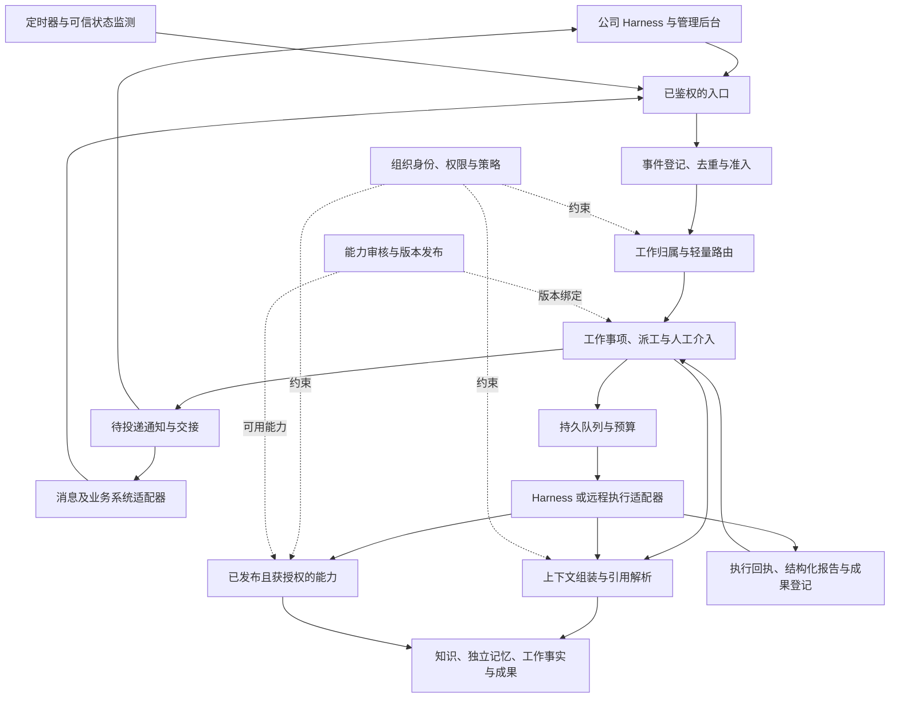
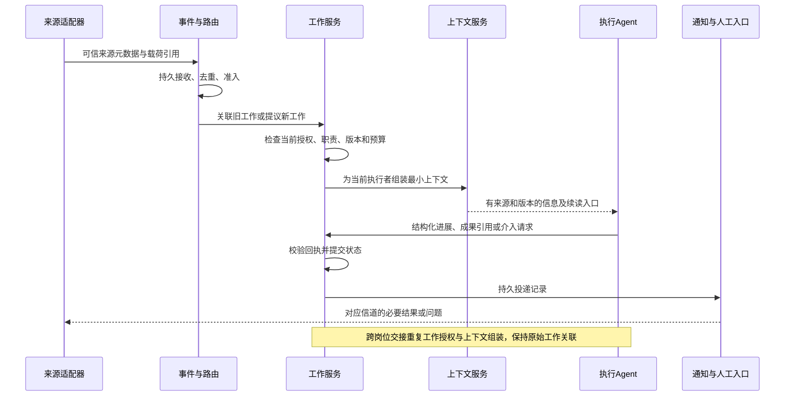
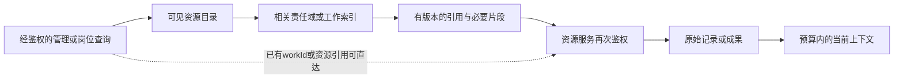

# 企业 Agent 协作框架：总体设计与四套运行规则

设计基线：1.1；日期：2026-11-14。适用项目：Company Agent Framework。

1.1补充分级回传、分层索引、检索路由、增量聚合及其验收规则。它们是工作与上下文契约的组成部分，不另造拥有全量上下文的中央Agent。

本文件是后续实现的设计方案，包含推荐定案、兼容要求、现状差距和验收条件；不表示设计中的新增能力已经实现，也不构成上线、迁移数据或扩大自动操作权限的授权。本轮只新增设计文档与入口链接，不修改源码、部署或运行配置。

当前基线以实际工作区为准：0.4 公司 Harness 已在本机隔离环境验证；云端保留0.3发行。本文查阅源码、现有协议和验收记录，没有在本轮重新运行历史测试或生产压测。本文设计版本不改变框架0.1插件ABI、现有manifest版本或员工客户端版本。

## 1. 定位、目标与边界

框架的定位是：在组织授权范围内，持续接收工作环境的变化，将其归入明确的工作事项，按需组织上下文，调用可替换的能力推进工作，以可核验的成果交接，并将经验证的经验积累为组织能力。

框架解决四个问题：工作怎样持续和交接；信息怎样读取和积累；事件何时引发行动；能力怎样验证和发布。公司部门、业务流程、领域数据模型、第三方平台规则由外部能力包和适配器定义。

目标同时包含个人执行效率和组织协作效率。日常进度由工作事实形成，报告按需生成，异常按责任投递；不要求员工为了让系统理解而反复整理全部聊天、重复汇报或手动维护模型Session。

### 1.1 必须保持的原则

| 编号 | 规则 |
| --- | --- |
| P01 | 人、岗位Agent、工作事项、执行尝试分别建模。岗位是长期工作身份；子Agent是可选执行方式。 |
| P02 | 组织层级决定权责和管理范围；工作可以跨部门并行。协作关系不强制复刻组织树。 |
| P03 | 身份、授权、工作状态、成果引用、审计和发布记录由可信宿主管理。模型提出建议，宿主决定是否受理。 |
| P04 | 资料分类、访问范围、内容版本分别管理。目录名、提示词、frontmatter和模型摘要不授予权限。 |
| P05 | 每次只提供足以推进当前工作的必要上下文；完整信息保留在可授权访问的权威存储中。 |
| P06 | 看到信息、发起工作、调用工具、分享资料和对外发布分别授权。事件到达不自动产生执行权。 |
| P07 | 重复事件不重复建立同一工作；不确定的外部结果先核实，不自动重放。 |
| P08 | 工作有可核验的事实和成果，模型说明有来源；未知、未执行、待批准和已完成必须区分。 |
| P09 | 新经验先成为候选，再经验证和适当审核发布。个人配置不得改写公司安全规则。 |
| P10 | 安装包、插件、Skill、SOP和触发策略分别版本化；更新可追溯，运行可解释，代码回退不伪称撤销业务副作用。 |

### 1.2 本设计不承诺的能力

不承诺任意HTTP/MCP地址自动成为可用业务系统、任意上传代码安全运行、模型永远正确、全部工作都可量化、无限上下文、所有操作全局恰好一次、无人负责的自动决策，或公司内网存储就意味着完全离线推理。

暂不采用全量微服务、全局单一大模型脑、每个部门单独复制整套服务器、全量事件溯源数据库重写，或用向量库替代业务数据库。先建设模块清楚的单体宿主，保留独立执行进程的边界。

## 2. 总体架构与技术落点

模型路由是ROUTE中的可选语义判断器。确定的归属、权限、去重、投递和状态变更用程序处理。路由模型只读取所属范围的工作摘要及必要引用，不拥有全公司完整上下文，也不默认配备任意文件、Shell和外部写工具。Router与Worker是逻辑职责，不规定必须一人一个常驻模型进程。

### 2.1 模块责任

| 模块 | 必须负责 | 边界 |
| --- | --- | --- |
| 身份与策略 | 公司、员工、部门、岗位、资源ACL、派工范围、当前有效授权 | 客户端和模型不能提交可信principalId或提升自身角色 |
| 工作服务 | 工作事项、任务分配、依赖、版本、等待原因、人工决定、交接 | 工作生命周期独立于模型Session和某次Run |
| 事件服务 | 来源实例、持久接收、游标、去重、准入、归属、订阅、决策记录 | 平台专用字段留在适配器和有版本的事件载荷中 |
| 上下文服务 | 可见资源检索、预算、来源/版本、摘要、续读、撤权失效 | 内容不成为指令或授权，摘要不绕过原文ACL |
| 知识与成果存储 | 文档版本、知识发布、私有记忆、不可变成果、来源和有效性 | 外部业务系统保持其数据权威性 |
| 能力与发布服务 | 包校验、审核、兼容、定向发布、禁用和回退 | 安装、挂载、授予权限、开启主动规则是不同动作 |
| 执行服务 | 运行准入、租约、预算、工具调用、取消、Checkpoint与结果核实 | Harness细节封装在适配器；不另造权限权威 |
| 投递与监督 | 持久待投递记录、收件箱、合并通知、进展监测、告警 | 监督者不能因发现故障而获得管理员或全员私有记忆权限 |

### 2.2 技术选择

保留TypeScript/Node、Fastify、PostgreSQL、pg-boss、现有JSON Schema/摘要校验、Harness SDK与公司桌面组合。实现时沿用锁文件验证版本；本方案不要求升级依赖或切换编排框架。

PostgreSQL保存权威状态、ACL、版本、事件接收记录和投递记录，pg-boss继续调度执行。状态变更与新派工/待投递记录在同一事务提交；网络调用在事务外完成。审计记录用于追溯，不将整个数据库改成事件重放系统。

原始文件经ArtifactStore端口存储，首版可用服务器受保护目录，后续可替换对象存储；数据库保存租户、ACL、摘要、大小和内容散列。下载通过授权引用完成，不返回自由文件路径。内网与云端使用相同契约，员工电脑只承载交互或明确注册的端侧执行能力。

检索先做带ACL的标识/关联查询和全文搜索；向量检索作为后续可替换实现，必须满足同样的授权和引用条件。没有必要在设计基线阶段指定额外检索集群。

### 2.3 Harness、MCP与内部A2A的位置

- 公司Harness是员工交互和受管执行入口，保留0.4同窗口登录、换岗、聊天和工作中心，逐步展示长工作状态及人工介入。
- Harness SDK/运行时执行模型循环，工具通过宿主授权；它不决定公司组织、知识ACL或工作是否最终验收。
- 接口、MCP和company-jsonrpc是能力接入方式。MCP提供上下文和工具等交换机制，不替本框架定义组织工作生命周期；其官方架构也明确不规定应用如何管理模型上下文。[MCP官方架构](https://modelcontextprotocol.io/docs/learn/architecture)
- 本文A2A表示受管岗位Agent之间的协作语义，不声称已兼容某个同名外部协议。同一部署先调用工作服务，跨部署以后通过可信网关映射同样的授权、交接与回执；不为每次内部交接强制增加一个网络跳数。
- 框架能力包agent-plugin、Harness原生界面bundle、第三方MCP服务是三种不同接入对象，由适配器连接，不能把格式相同作为默认假设。

## 3. 统一对象与四套规则的衔接

| 对象 | 定义 | 连续性和权威 |
| --- | --- | --- |
| Actor / Agent | 人的身份、长期岗位工作身份及配置 | 公司身份和配置服务 |
| WorkItem | 一件需要持续跟进、交付或决策的工作 | 工作服务；不等同一次聊天或单个外部客户/订单 |
| Task / Assignment | 在某项工作内分配给执行岗位的一份职责 | 工作服务；保留当前任务ID，扩充分配元数据 |
| Run | 一次实际执行尝试 | 执行服务；可失败、取消、核实后再建立新尝试 |
| Session | 模型或用户交互的上下文载体 | 可关联工作；不是工作状态权威 |
| Event / Thread | 一次来源变化、同一来源话题/对象的事件串 | 事件服务；Thread与工作为多对多 |
| AuthorizationRecord | 这项工作在何种身份、策略和范围下被受理 | 宿主创建，绑定记录；执行仍检查当前授权 |
| ResourceRef / Artifact | 资料引用、版本或可核验成果 | 资源服务及其原始来源 |
| ContextPack | 某次决策/执行实际使用的信息及引用清单 | 上下文服务；有读取者、目的、预算和授权代数 |
| ReleaseBinding | 精确绑定能力、Skill、预设、策略及内容摘要 | 发布服务；保留审计版本，紧急撤权随时生效 |

四套规则共同形成如下链路：

## 4. 规则一：工作持续、跨Agent交接与结果汇总

### W01 工作事项独立存在

WorkItem至少保存companyId、title、goal、createdBy、负责人、状态、revision、受理依据、验收方式、关联来源、任务/成果引用和时间。领域实体只以带命名空间的subjectRef引用，不向内核增加客户、发票、产品或投放字段。

任务成功表示执行尝试产生了结果；完成工作需要满足验收条件。新工作默认保留当前人工核对规则；自动验收只能由已发布策略显式启用，并有确定的检查器和适用范围。模型不能自行把人工验收改成自动验收。

### W02 身份、授权和责任分开记录

保留发起人、派工岗位、执行岗位/所有者及人工审阅者，分别记录。目标岗位使用自己的当前有效工具授权执行，同时受到本次受托范围、公司规则、数据分享范围及审批限制。

派工者不必拥有目标岗位每一项工具权限；他必须有明确的委派权限，且请求的操作类别在允许委派范围内。目标具有的能力不会自动借给任意发起者。宿主根据身份与已发布委派策略生成AuthorizationRecord，不能相信模型正文或JSON中自称的授权。

### W03 结构化交接

交接单至少包含workId、taskId、目标/验收条件、必要资源引用、交付范围、截止时间（可选）、预算、当前结论及未解决问题。宿主附加发送者、接收者、授权记录、版本与来源事件，模型只能填写业务意图和候选引用。

操作分为request、context_update、progress、result、attention、cancel_request。信息更新不扩大工作范围。新目标、额外对外动作或更大资料范围必须重新检查/生成受理依据，必要时建立新的相关工作。传引用前先确认发送者有分享权、接收者有对应读取权；拥有读取权不默认拥有发布权。

接收回应区分accepted（持久受理）、started、waiting、result_ready和reviewed。accepted不意味着已经执行，任务执行成功也不等于已经获准对外发布。交接超时不得由另一岗位悄悄重复执行同一项不确定操作。

### W04 连续性与状态

沿用现有queued、running、waiting_review、completed、changes_requested、needs_attention状态词，后续增量加入cancelled。等待条件用waitReason表示，如human_decision、approval、dependency、environment_unavailable或reconciliation，避免把所有等待解释为失败。

任务/Run保留waiting_approval、reconciliation_required等现有语义。WorkItem汇总须明确必需任务、可选任务和依赖完成条件，不再永久只按“全部tasks成功”推导。没有配置时维持旧版全部成功后人工核对的行为。

人的补充、审批或修改意见进入原工作。继续时读取Checkpoint及有效输入，建立新的Run；不能重新发送所有已完成动作。人工审核绑定工作/成果revision，成果变化后旧审核不覆盖新结果。需返工时保留上一份成果和审核历史，创建新一轮分配；不覆盖原Task/Run的终态。

人工/依赖/环境等待保留工作与Checkpoint并释放执行槽；接收新输入后重新准入，不用模型空转等待。Checkpoint保存已确认动作的回执、待办、输入处理游标和资源引用，不假称可恢复供应商内部推理。审批继续时仍检查精确工具、输入摘要、版本及有效期；已过期或输入变化时重新申请，不能复用旧批准。

停止请求优先于普通补充，先标记stop_requested、禁止新副作用，再确认正在运行的执行是否已停止。取消并不撤销已完成的外部操作；仍有不确定回执时保留needs_attention和核实工作。

已完成工作的后续请求，经有效的人或策略重新受理后进入新一轮，保留旧成果和审核；扩大目标时建立关联新工作。已明确停止的工作不因旁观消息、重投事件或模型判断自行恢复，必须有新的有效启动决定。

### W05 并发与冲突

不同任务可并行，最初保留单岗位同一时刻一个活动Run及当前分派限制。扩并发以真实负载和冲突控制验收为前提，不按部门数量直接增加常驻会话。

依赖图必须无环，并有总扇出、深度、时限、费用/token预算。不能通过嵌套A2A生成无限工作树。共享资源修改使用版本比较、租约或由适配器提供的条件写；发现同源冲突转人工或串行，不依赖两个模型在聊天中自行达成锁。

### W06 事实与报告

结构化报告保存实际状态、成果引用、执行回执、未完成项、阻塞原因、下一责任人和需人决定的问题。模型总结作为解释文本，进度比例只有存在可计算分母时才显示。

成果至少登记版本/散列、创建者、关联工作、来源、ACL和验证状态。区分“模型声明已完成”“工具返回成功”“外部系统已确认”“人工已验收”。主张已写入外部系统时，应有对应系统对象或可靠回执；缺少时标记待核实。

管理查询只汇总可见工作事实和成果，不读取所有下属私人聊天。正常进展更新工作视图；通知默认只覆盖需要决策、验收、超时、失败或有价值的结果，并按收件人/工作/事件类型去重合并。

工作状态可见不自动等于报告正文及全部成果可见。结果文本、附件和摘要按来源继承访问限制；对有管理权限但无敏感内容读取权的人，提供经过授权筛选的状态和决策请求，不泄露原始资料。

### W07 分级回传与最小登记

“数据回传”分别指持久保存、目录/索引登记、向收件人投递、注入模型上下文。四种动作采用不同策略。数据物理上保存在同一公司服务器，仍可按工作/部门/Agent分域管理；不能因已经入库，就把正文复制给统筹Agent或默认开放公司搜索。

| 数据类别 | 默认保存/登记 | 默认回传内容与时机 | 需要详情时 |
| --- | --- | --- | --- |
| 执行控制事实 | 可信宿主工作/运行账本 | 必须登记受理、状态变化、完成/失败/未知、控制revision和必要回执身份；计量与安全审计同样不可由模型省略 | 按权限查任务、Run和回执，不把全部日志交给管理模型 |
| 可交付成果 | 受管成果存储，或登记的权威外部系统 | 符合验收要求时登记不可变引用、版本/散列、验证状态、可见范围；对收件人只投递有权获得的摘要/引用 | 授权读取完整文件或对应外部系统记录 |
| 普通过程数据 | 执行域/受限存储，按留存策略处理 | 草稿、重复工具响应、调试正文、完整聊天不默认逐层回传；必要控制事实仍登记 | 为明确的核对/排障目的读取限定片段，记录访问 |
| 异常与待决事项 | 原工作和受限诊断资料 | 及时投递给有权处理的人：影响、阻塞原因、需要的决定和证据引用；不默认附整段敏感日志 | 原位查阅授权诊断资料；未知结果保留核实状态 |
| 管理摘要和统计 | 工作事实的派生视图 | 状态变化时增量更新；按订阅、周期或查询返回，不逐事件给老板发消息 | 从指标追溯到可见工作、成果及来源 |
| 候选经验 | 个人/岗位候选区 | 记录适用条件和来源，依R05审核后才进入团队/公司知识目录 | 经授权读取验证记录和源工作，不能自动公开私人记忆 |

ReturnPolicy由已发布的公司策略、工作契约和数据所有者规则共同约束，明确requiredFacts、summaryAudience、artifactRegistration、detailRetention、notificationConditions和敏感数据处理。插件只能声明请求/产出，模型只能建议补充说明，二者不能关闭必须登记的失败、未知结果或计量，也不能扩大收件范围。

最小回传信封包含workId/taskId/runId、生产者绑定、状态/revision、变化时间、必要结果摘要和证据/成果引用。摘要、资源标题、路径、数量及存在性也按受众筛选；不在通用事件信封塞完整业务载荷。完整资料的保存位置由资源策略决定，登记引用不要求复制外部业务库的全量记录。

普通进展可按工作合并delta，同一revision不重复更新；失败、停止确认、结果未知和人工决定请求及时登记。批量合并不得丢掉这些关键状态；乱序旧revision不得覆盖新结果。登记的成功回执不等于成果已验收，临时文件只有完成受管保存或权威外部引用核验后才能作为可交付成果。

## 5. 规则二：资料、长期记忆与当前上下文

### C01 内容、范围、信任分别标记

内容类别沿用公司基础知识、业务/管理资料、工作记录，另管理经验证的岗位经验。访问范围采用公司、部门/团队、项目/工作、Agent私有及显式分享；单个资源可有明确ACL，不强制一份资源复制到多个目录。

来源可信度至少区分宿主控制规则、公司已发布知识、外部系统事实、任务产物、外部消息和模型派生摘要。保存source、version、observedAt、owner、classification、validity及派生关系。系统/业务事实时间与接收时间分开。

外部消息、文档、工具返回或记忆里出现的“管理员要求”只能当资料。公司有效规则来自受控配置/发布渠道，文档内容不能自己升级成系统指令。

### C02 权威性与冲突

当前权限以身份/策略服务为准；业务当前状态以登记的权威系统为准；SOP按发布的生效版本处理；记忆和总结保留来源并在事实可能变化时重新读取。

任务可固定知识/SOP版本以便复现，但法律/公司强制规则（如部署方配置）、紧急停用和撤权仍按当前有效状态执行。发现规则冲突时暂停受影响操作并请求判断，不由模型任意挑选有利版本。回看历史时明确当时版本，不能把旧规则当作当前许可。

### C03 ContextPack组装

每次路由判断、执行恢复、跨岗位交接、重要新输入后，按目的组装或验证ContextPack：

1. 宿主绑定读取者、岗位、workId/taskId、目的、目标模型/执行环境及当前授权代数。
2. 读取最小职责、允许能力、工作状态、最新指令和关键决定。
3. 在已授权资源集合中检索，选择必要知识/事实/成果引用；不先向模型暴露全库候选再过滤。
4. 将小且高概率要用的信息内联；长内容保留摘要、来源、版本、明确的截断标志和授权续读入口。
5. 预留模型输出、工具返回和新事件空间，记录实际采用/省略的来源及原因；超预算不得静默删掉约束或停止指令。
6. 发送前复查权限和任务控制版本；生成期间版本变化则丢弃该包或重新组装。

固定的核心规则不由一般资源排序挤出。无法容纳最小安全信息时拒绝本次执行，或要求缩小工作；不靠压缩规则继续运行。预算按所用模型能力设置，复用当前字节/字符上界作保守保护，后续增加模型相应的token计数。不给所有模型硬编码同一个上下文长度。

### C04 按需召回与多跳引用

统一ResourceRef概念：命名空间、资源ID、版本/更新时间、摘要、来源与读取方式。读取结果可附下一跳关联引用，形成工作、事件、成果、知识之间可逐步展开的关联；每一跳重新授权，并限制读取字节、跳数与工具次数。

稳定知识的分页固定内容版本和游标；动态业务事实标明读取时间/版本，版本改变后重新检查，避免把两次读取混成不存在的状态。续读不接受任意URL或磁盘路径；登记的适配器负责可信来源解析与防重定向泄密。

### C05 摘要、缓存和撤权

摘要是派生资源，保存依据、版本和覆盖时间。默认继承源内容中更严格的访问约束；多来源摘要不得向只能读部分来源的人泄露另一部分。面向不同受众分别生成经筛选的摘要，不能只在末尾删掉来源链接。

缓存按公司、读取者/有效授权、资源版本、用途及策略代数区分。检索索引先限定范围，返回前再检查；删除、过期、撤权和源版本更新触发失效。摘要变更记录来源链，原文仍可追溯。

已进入模型的内容无法保证远程撤回。撤权后阻止进一步取用/分享，失效旧连接及运行授权；必要时停止旧会话并用当前可见资料建立新上下文。删除或脱敏按部署方的保留政策处理，并明确备份和外部模型的边界。

### C06 记忆写入与经验发布

保留每Agent私有笔记的版本比较写入和Markdown投影。组织资料通过资源与知识服务发布，不把原来私人记忆自动改成部门共享。

工作日志、个人偏好、未经验证的观察、候选经验、已发布SOP分别标记。经验路径为“记录→候选→验证→审核→限定范围发布→反馈/停用”；记录来源工作与成果、适用条件、反例和验证依据。个人风格允许在公司约束内自主调整，公共规则和工具权限不由个人反馈自动改变。

记忆摘要不能作为系统事实的独立确认。重复任务中的过时偏好或错误经验可更正/废弃，保留修订关系；长期记忆需要按有效性整理，不无限堆积原始聊天。

### C07 对外发送边界

资料可在公司存储，也可能经提示词/工具发送到外部模型或服务。资源可配置允许去向；ContextPack和工具出口检查该规则。公司Key通过宿主连接代理使用，不放入上下文、包、报告和普通日志。

内网部署与云部署沿用同一读取契约。员工端仍可能保存聊天缓存，不能把权威数据集中保存解释为终端零数据。需要完全离线时接内网模型和内网能力服务。

### C08 约束实际模型请求

ContextPack是宿主选取信息的结果，还必须与Harness实际发送的输入衔接。当前原生会话会携带自己的聊天历史，单独生成一份ContextPack不会自动清除旧历史或控制全部模型窗口。目标适配器必须明确哪些指令/引用由公司注入、哪些对话被保留、何时需要新建执行上下文；网关检查最终实际请求的预算、工具及授权代数。

不同工作的执行上下文默认隔离；用户界面可在一个聊天入口讨论多项工作，由明确的工作关联选择输入目标。不能把一次全部界面历史自动传给所有后台Worker。更新上下文时必须保留合法的工具调用/结果配对，不任意剪切中间协议消息；必要时以Checkpoint和授权摘要新建会话，而保留旧聊天供用户查阅。

原生适配器、SDK后台执行和远程运行都须通过同一组有效输入与来源验收。模型的原始上下文不作为默认日志输出，也不通过管理摘要扩散。

### C09 分层索引与资源归属

索引分成三个逻辑层次，按资源责任域组织，可覆盖部门、项目、工作或共享知识，不强制等于组织树，也不要求各层独立建数据库或启动Agent。

| 层次 | 保存什么 | 不默认保存/暴露什么 |
| --- | --- | --- |
| 组织资源目录 | 可见资源域、可提供的查询能力、责任主体、授权入口和索引版本/水位 | 所有岗位笔记、完整成果正文、私有域的标题/存在性；无权限的目录项也须隐藏 |
| 责任域/工作索引 | 在该范围可检索的资源/工作引用、必要摘要、内容类型、来源/版本、更新时间、派生关系和ACL标识 | 全量原始载荷；仅有索引入口不等于获得范围内全部资料 |
| 原始记录与成果 | 权威业务记录、文档版本、受限工作记录、私有记忆和完整文件 | 不为逐层汇报而复制多份原文；读取始终由资源服务或受信适配器鉴权 |

索引可使用同一PostgreSQL中的分域表/视图及后续可替换检索实现；索引位置是实现选择，ACL与查询契约始终一致。资源能被检索发现、能读摘要、能读原文、能分享给他人分别授权。向量表示、关键词、统计和关联图同样属于派生数据，需要继承适当范围。

每个资源登记权威来源、责任主体和稳定引用。负责人/存储位置变化时更新解析与失效旧索引，不要求所有上层Agent修改自己保存的原文副本。新域只需注册目录/查询契约与授权策略，框架不增加该部门的业务字段。

### C10 检索路由与按需展开

检索遵循以下顺序，框架执行确定的筛选/解析，模型只在必要时辅助理解查询：

1. 绑定查询者、目的、工作范围和预算；验证引用及候选域是否允许访问。
2. 已有workId、成果或资源引用时直接定位，避免每次都从公司目录重新查找、层层询问负责人Agent。
3. 归属不明时，在可见目录中定位相关域；先查当前工作及明确相关资料，再按授权扩展到共享知识/其他责任域。精确查找失败可直接进入合适的授权域，不要求机械地逐层遍历。
4. 返回有数量/字节上限的授权结果：摘要、来源、版本、时间、匹配依据和续读引用。全文和语义检索的候选选择之前限定授权范围，返回之前再次检查；不得先把全库命中交给模型再过滤。
5. 只有当前判断确实需要的资源才展开为限定片段，进入ContextPack；预算不足时保留续读入口或提出缩小范围，不递归拉取所有关联对象。
6. 结果同时报告asOf、检索覆盖范围和缺失/离线来源。明确区分“已搜索且无匹配”“当前无权/无法覆盖该范围”“来源暂不可用”；对无权用户使用不暴露具体资源存在性的提示。

部门负责人Agent无需成为所有检索请求的代理。可以授权宿主资源服务直接完成索引查询和读取；确需该岗位解释、判断或执行工作时，再通过受管A2A派工。读取信息本身不新建一棵Agent协作树。

### C11 增量索引、聚合和失效

资源/工作提交后，宿主在同一事务记录版本和索引更新意图，再异步更新派生索引/汇总。索引消费者按resourceId、revision及幂等键处理，拒绝旧版本覆盖。状态与索引版本可核对；断线、延迟和重建期间保留待处理记录。

读取当前工作状态、审批或执行下一步动作时，以权威状态核验；最终一致的搜索索引只帮助定位。索引落后且无法核实最新事实时返回stale/待核实，不把旧摘要解释成当前已完成。索引内容和缓存撤权按C05处理；删除、停用或转移形成失效标记，避免旧引用继续可见。

管理汇总尽量由结构化事实计算，明确统计口径、工作/时间范围、去重键、源revision/水位及是否完整。跨部门引用同一工作不重复计数；有过滤或来源缺失时标明范围，不能把局部结果说成公司全貌。只有有权读取对应聚合的受众才能获得统计，计数也可能泄露敏感活动。

模型基于这些事实解释或起草报告，引用仍指向可查的工作与成果。避免“员工模型总结→部门模型再总结→公司模型再总结”成为唯一事实来源；每层汇总都应能回到授权的原始结构化事实，纠错后可以重建派生视图。

## 6. 规则三：触发、归属、执行与投递

### E01 来源与事件信封

来源适配器将平台事件转换为统一事件。宿主可信字段包括companyId、sourceInstanceId、externalEventId、actorMapping、originKind、receivedAt、traceId、rootEventId、causationId；适配器提供occurredAt、threadRef、subjectRefs、eventType、payloadRef、载荷Schema版本和摘要。来源的完整配置、签名验证、平台租户/成员映射和凭证留在适配器及宿主。

事件接收使用(sourceInstanceId, externalEventId)加公司范围去重，并核对内容散列；同身份不同内容返回冲突。平台编辑/撤回作为新版本事件；接收时间不替代发生时间，来源序列缺口可补拉。

消息载荷自带的principalId、workId和“已获授权”不可信。workId只能在宿主验证发件人/来源与既有绑定后用作归属候选。

### E02 持久接收后再确认

先登记事件和接收状态，再向来源确认；进程重启后根据游标和待处理记录恢复。系统采用至少一次传递、幂等消费和回执去重，不宣称跨所有第三方的全局恰好一次。

外部I/O不占数据库长事务：短事务登记/认领工作，模型判断或网络调用在事务外进行，回写时比较事件、策略、工作revision及租约代数。过期执行者不能覆盖新决定。

### E03 准入与语义判断

确定性规则先处理来源有效性、成员范围、启停、重复、已知归属、速率/预算及允许事件类型。明确可忽略者记录去向，不调用模型。已知确定动作可直接进入受控工作命令；语义不明确的候选才调用轻量判断器。

语义判断可建议ignore、attach_existing、propose_work或request_clarification，必须附原因和引用。宿主验证候选工作、范围、当前授权及可用预算。不能由自然语言策略覆盖程序权限；无判断能力或调用失败时标记unavailable/待处理，不能冒充已忽略或已完成。

### E04 旧工作直达、新工作路由

已绑定且仍有效的Thread→Work/Task订阅，让后续事件直达负责任务的输入队列。每次直达仍检查来源、接收范围、任务存活和数据ACL；它只减少重复路由推理，不跳过授权。

一个Thread可有多项工作，一项工作可关联多个Thread。每个输入有明确处理者和确认游标，观察订阅与行动订阅分开。多个观察者可获得授权摘要，但不得各自重复创建同一工作。归属含糊时暂停分派或请求一次澄清，不强行猜测。

Worker发现新信息超出当前范围，向工作服务提出移交/扩大范围候选，由宿主重查。跨任务协调交给路由层，路由层无需转发每一条已确定归属的消息。

### E05 主动规则的范围

策略至少保存来源范围、触发条件、模式、可委派能力、可用资料范围、最大影响、预算/时限、冷却、执行/通知目标和审批要求。初次接入使用observe（只记录会如何处理），验证误触发后再开放已批准的动作；执行模式受发布记录控制。

显式请求与依据规则推断出的候选分别记录。外部旁观信息可触发已获准的读取、检查或草稿工作，任何对外承诺/写入仍需对应授权和审批。没有规则时保持待处理/通知适当负责人，不自行创造常驻自动化。

### E06 合并、顺序与防循环

同一Thread的普通短时变化可批量判断，但保留每个事件ID和可追溯去向。停止、撤权、紧急禁用优先处理，不等待普通批次；同一工作控制指令有顺序和revision，避免旧完成消息覆盖新停止决定。

事件保留根因链、来源类别和自动化深度。Agent自身报告、通知送达回执和自动辅助产生的事件不默认触发另一轮自动工作。相同根事件/规则/目标去重，并设最大扇出、最大深度、冷却及公司/员工预算，防止“报告触发报告”和告警风暴。保留当前“已知失败才受限辅助一次、未知结果只通知”的规则。

### E07 等待、投递与监督

定时器保存明确时区、到期时间及幂等身份；到期重新鉴权，不占一个模型会话持续等待。内部时间保存UTC，界面按用户/公司时区显示。

状态提交与outbox记录同事务；投递器在事务外发送。投递有幂等键、收件人/信道、尝试状态和来源回执，断网后可恢复。渠道若不能去重，发送结果不确定时必须先核实或告知可能重复，不能声称已保证不重发。授权下载链接投递/打开时检查访问范围，不把内部UUID或临时Token当作公开权限。

每次实际投递前重新检查收件人、信道、资料/摘要权限和工作控制版本；排队期间撤权则停止相应内容投递。outbox已登记不构成持续发送授权，已经发到外部的内容也不能假称可自动收回。

心跳、超时、预算、重复无效调用和Checkpoint变化由确定性监督先处理，必要时再让受限模型解释。监督者只能在批准范围内重启明确未执行的步骤、收集诊断或通知负责人；不直接改公司策略、插件版本或无限重试副作用。

## 7. 规则四：能力审核、发布和统一更新

### R01 接入对象及统一外层约定

保留agent-plugin.json、JSON Schema、精确版本、依赖声明、module/remote入口及现有协议1.0。JSON-RPC承载采用现有2.0格式；两者版本含义不同。现有schemaVersion 0.1/0.2继续按原规则读取，不直接向旧Schema塞入未知字段。

新增Source、ContextProvider、Skill/预设等扩展时先定义版本化Schema和兼容表；可在原包外加市场元数据，不要求重写所有旧插件。能力目录声明“提供什么”，宿主授权决定“谁能使用、用于哪项工作”。工具effect标签是声明，不是对恶意代码的隔离保证。

工具/MCP/HTTP适配仍必须交代输入输出、错误、异步状态、取消、幂等、数据去向和真实回执。Source额外声明事件Schema及接收/补拉方式；ContextProvider额外声明权威性、版本/分页与访问检查方式。所有声明经宿主校验，不能自行注册更高权限身份。

### R02 上传、审核、发布、授予分开

员工可提交候选包、Skill或SOP及说明，先进入无执行权限的隔离待审区。流程为draft/submitted→checks→reviewed→approved→published；拒绝保留原因，发布版本不可变。已发布版本可deprecated或suspended。

自动检查覆盖Schema、摘要、依赖、来源、敏感信息/凭证、能力与数据范围声明及通用行为契约。人工审核检查用途、影响、维护人、证据和适用范围。测试环境凭证与资料独立，不能用生产Key测试任意上传代码。

签名/散列能验证来源与完整性，不能证明代码安全。当前本地worker没有OS级沙箱，因此只执行公司已审查的可信代码；开放不可信代码市场前必须增加真实隔离或限定为受信远程服务。候选上传本身不得启动插件生命周期、依赖安装脚本或任意命令。

发布、安装、挂载、用户/岗位授权、开启自动触发、允许对外写入分别审计。平台运维权限与敏感资料读取/业务审批权限后续细分，不能永远靠一个全能admin承接全部职责。

### R03 运行版本与更新

每项工作记录ReleaseBinding，包含所用插件/Skill/预设/规则版本与内容摘要；Run记录实际执行绑定。普通更新不静默改变活动工作的行为，默认排空后切换或在安全Checkpoint显式采用新版本。紧急禁用阻止后续调用，受影响工作转待处理并保留原回执。

升级采用候选验证→限定员工/岗位试用→扩大范围→发布/回退。回退代码、配置、知识指针分别记录，不能覆盖历史，也不能自动撤销已发生的外部修改；需要业务补偿时由对应能力显式定义并批准。

### R04 公司软件更新

继续0.4公司Harness源码组合方式和固定上游来源，优先独立原生插件，必要的桌面组合改动可追踪。客户端、宿主协议、能力包ABI和知识版本独立编号，有明确兼容矩阵；官方上游自动更新不直接决定公司发行。

统一渠道需要公司签名/受信来源、完整性校验、灰度、活动任务排空、失败回退和最低安全版本策略。离线电脑保留已验证版本；遇不兼容服务拒绝新任务并清楚提示，不能边升级边破坏执行。凭证不放安装包，云端与内网只改变受管服务地址和受信证书配置。

### R05 经验进入市场

候选经验与来源工作、成果、反馈关联，先验证适用边界。已发布SOP可被引用到预设/Skill，但不得直接成为程序权限；发现反例可撤回/新发版本。管理员比较实际质量、返工、耗时和人工介入情况后决定推广，不能只看输出数量或模型自评分。

## 8. 跨Agent协作的最小契约

以下为目标契约示意，尚未实现为新的API。业务包仅提供goal/input/output和领域引用；身份、授权、revision与派工记录由宿主附加。

| 契约 | 请求包含 | 宿主补充/验证 | 返回 |
| --- | --- | --- | --- |
| ReceiveEvent | externalEventId、threadRef、载荷Schema与引用 | 来源实例、公司/成员映射、去重和来源可信度 | 持久接收回执及去向 |
| SubmitWork | 目标、候选岗位、输入引用、验收条件、幂等键 | 当前委派授权、可分享资料、ReleaseBinding、预算 | workId/taskId、accepted或明确拒绝 |
| DeliverInput | 已知workId/taskId、事件引用、期望revision | 订阅绑定、当前作用域、输入游标 | 已接收/待澄清/范围变化 |
| ComposeContext | 工作、执行目的、候选资源和预算 | 当前身份、资源ACL、版本、数据去向、控制代数 | ContextPack及截断/冲突说明 |
| ReportResult | 结构化状态、成果/回执引用、未完成项 | 运行身份、实际工具回执、成果归属、工作版本 | result_ready或待核实 |
| RequestAttention | 一个可回答的问题、候选选项和影响 | 有权决策者、暂停范围、当前revision | attentionId与waiting状态 |
| ReviewWork | revision、决定和依据 | 人的身份、审核范围、与执行者分离规则 | 已审核/版本冲突 |
| CancelWork | workId、期望revision、原因 | 发起/管理权限、取消代数、运行确认与不确定回执 | stop_requested，随后明确终态 |

发送方只可转交经授权的资料子集，接收方按自己的读取身份形成ContextPack；不转发发送方的整段系统提示、完整私有聊天、模型Key或身份Token。父工作保留关联及预算，目标工作记录自己的责任与成果。

长操作返回accepted并在后台推进。后续更正、停止或人工介入按工作控制队列送达，在安全边界生效，不等待全部后台命令结束。Task/Run只有一个当前有效执行租约及代数，过期执行者仅能提交待核实证据，不能覆盖新状态。

内部A2A可由工作服务完成。跨公司、跨部署、互联网Agent发现和第三方A2A协议互通放在后续网关适配范围；不让外部Agent因符合消息格式就获得公司成员身份。

## 9. 数据、服务边界与兼容

### 9.1 增量数据模型

保留actors、agents、departments、memories、tasks、runs、usage、approvals、work_items、work_assignments、work_reviews和现有assistant表。新增或扩充的逻辑集合为：事件来源/接收游标、Threads及订阅、工作输入及处理游标、授权受理记录、Checkpoint、资源与成果版本/ACL、ContextPack来源清单、知识候选/发布、能力审核/发布记录、outbox。

补充逻辑集合：资源域目录、按范围检索索引、回传策略、管理汇总投影及其处理水位。它们保留与权威资源/工作版本的关系，不建立第二份可以独立改写业务事实的总账。原始内容、最小登记、索引、汇总和模型上下文分别有保存/更新策略。

多轮派工需要分配代次和当前分配指针，兼容现有(work_id, agent_id)唯一约束；迁移方案应增量承接历史而非直接覆盖旧行。旧查询默认返回当前代次，历史执行另可追溯，旧审核不能覆盖新代次。平台来源实例、资源和所有新增唯一键须含公司/部署命名空间；不把现有全局Actor主键直接当作跨公司SaaS隔离已完成。

逻辑集合不要求一开始拆成独立服务。work_items继续作为工作权威；新增工作变更服务收敛写入口，不能同时由Assistant、Router和执行器各自修改真状态。工作/输入/outbox使用事务和revision；外部资源、模型和IM发送采用事务后副作用。

现有审计做必要扩充：关联company/work/task/run/event、操作者及发起者、授权/策略版本、能力/知识绑定、ContextPack引用、收尾状态。默认不把完整上下文、密钥或私有资料正文写入通用运维日志。保留策略、删除、索引和备份由部署方明确配置，不在内核写死某行业年限。

### 9.2 内部接口和公共HTTP

内部建议用窄接口连接工作、上下文、来源、执行、投递与发布服务，Framework保留兼容门面及统一授权；不要让每个模块直接调用其他模块数据库细节。创建/更新的输入输出应逐步替换SDK中的unknown为版本化DTO。

现有/v1/work、/v1/tasks、/v1/assistant/*、/v1/bot/messages、记忆和渠道API保留。旧消息入口映射为带来源的事件后仍返回原任务回执；旧工作缺新字段时使用显式legacy默认值。新资源、工作输入、ContextPack和市场审核API单独增加，不静默改变旧字段语义。

新命令统一幂等键、输入散列、预期revision、状态、受限错误与证据引用。401/403、版本冲突、等待批准、容量不足和结果未知分别表达；不把所有失败包装成“请重试”。协议升级及废弃通过兼容矩阵安排，不用客户端版本号推断插件Schema版本。

### 9.3 部署与持续在线

同一控制面可以在云端或公司内网运行。首阶段保持一个权威宿主及当前HostLease独占，先解决恢复和可靠性，再评估多副本。多副本需要将进程内连接/作用域、调度租约与故障恢复重新设计；增加容器数量不会自动获得高可用。

长期后台工作保存于服务器。公司Harness保留交互缓存但不成为工作状态唯一副本。需要员工电脑工具的工作声明执行环境；电脑离线时等待/改派已授权环境，不能伪造继续执行。通用端侧daemon、任意跨设备命令与离线本地模型不是本方案首阶段默认开启能力。

当前数据库schema由FRAMEWORK_ROOT路径派生。后续应增加稳定deploymentId与版本化迁移，避免换目录改变命名空间；迁移前显式核对原schema、DB及state/vault主密钥，不直接改路径后启动新空库。更换部署时先在新隔离环境恢复演练。

## 10. 与当前项目对照：保留、调整与新增

下表来自本轮源码核对和既有验收记录。标为“保留”不表示已经满足所有目标规则；每行写明仍需增加的职责。

| 当前实现/证据 | 判断 | 后续处理 |
| --- | --- | --- |
| src/types.ts、organization.ts；Actor、Agent、部门/汇报线和team权限 | 保留并扩展 | 增加资源分享、受托操作范围和敏感数据/运维职责分离；不重造身份体系。 |
| src/index.ts；统一授权、批准、版本发布和服务转发 | 保留门面，收敛内部职责 | 保持权限入口，抽出工作/上下文/发布窄接口；避免继续堆积跨模块条件分支。 |
| src/plugins/registry.ts、worker.ts、remote.ts；Schema、不可变摘要、模块/远程工具 | 保留 | 在安装执行之前增加候选审核状态；补Source/知识/Skill版本契约，不把worker进程当沙箱。 |
| src/plugin-sdk.ts、plugin.schema.json；工具级Host服务和兼容版本 | 保留兼容 | 逐步补版本化DTO、工作输入/成果/上下文服务；旧Schema继续验证，扩展显式版本协商。 |
| src/memory.ts: MemoryStore、buildContext转发；Agent私有笔记、CAS、来源、字符预算、搜索/双链 | 保留私有层，新增上下文服务 | 现有ContextRequest仅noteIds/maxChars，需增加工作、资源类型、ACL/版本/有效性、多跳引用和来源清单；它还不是完整组织记忆治理。 |
| src/harness-clients.ts；连接/会话/回合身份，INDEX注入、旧授权失效 | 保留安全绑定，调整上下文入口 | 接入ContextPack与workId/taskId，按C08处理实际原生历史与最终模型输入；进程内lease不承担长期工作连续性，服务恢复后重建连接。 |
| src/work.ts: WorkCoordinator；原子派工、工作可见性、结果revision、人工核对 | 保留工作主键和原有行为，扩生命周期 | 当前每个工作每Agent一份分配，状态主要由任务推导；增加持续输入、多轮派工/返工、条件依赖、停止/恢复和验收策略。 |
| src/tasks.ts中的结果output、work.ts中的结果汇总及现有报告 | 保留执行原文和回执历史，调整默认回传契约 | 引入W07分级信封、成果引用、受众筛选和delta；现有自由文本output不直接充当全公司索引或必传管理上下文。 |
| src/tasks.ts: TaskQueue/TaskExecutor；pg-boss、任务幂等、执行者身份、预算 | 保留调度和执行端口 | 扩展任务输入/Checkpoint及受控恢复；当前队列任务360秒配置和Run短租约不能当作长工作生命周期。 |
| src/runtime.ts: HarnessRuntime；运行准入、模型/MCP网关、计量、取消 | 保留实际执行能力，分离内部关注点 | 将工作状态提交、ContextPack、执行适配与模型计量边界收紧；保持Harness为默认适配，不重新实现模型循环。 |
| src/bot.ts: BotGateway；来源身份、消息幂等后建任务 | 保留入口及幂等回执 | 当前新messageId通常新建Task；经事件归属服务识别旧工作跟进、跨信道绑定与停止，不能继续一条消息一项独立工作作为唯一模式。 |
| src/assistant.ts；事件、规则、定时提醒、内部收件箱和失败辅助 | 保留确定性规则与提醒 | 当前规则按eventType/来源白名单匹配固定分配；拆分来源接收、归属、语义候选、通知及监督，增加observe、订阅、游标、决策记录和outbox。 |
| src/channels.ts；加密连接、账号组并发、Key轮换、目录/用量 | 保留 | 增加资源数据去向策略和发布/工作关联；模型Key继续只在宿主使用，号池不扩个人或任务授权。 |
| src/persistence.ts；PostgreSQL权威数据、当前增量DDL | 保留数据库，调整迁移治理 | 版本化迁移、稳定部署身份；增加资源/事件/输入/发布集合，避免启动DDL成为不可审计的长期迁移方式。 |
| src/host-lease.ts；独占宿主锁 | 保留 | 初期单权威实例；高可用另立验收，不能提前解除锁后任意开多实例。 |
| desktop/company-main.mjs、client/company-session.mjs、packages/harness-workspace | 保留0.4单窗口路线 | 继续工作视图、持续输入/人工介入和有效授权刷新；不回退成0.3双软件启动方式。 |
| vendor/harness-desktop、harness-desktop.lock.json、公司构建脚本 | 保留固定来源/许可/摘要 | 公司签名、安装器和OTA另行完成，不能声称已经完整源码重建上游全部运行时。 |
| web后台；组织、岗位、记忆、日志、用量和协作页 | 保留并扩展 | 增加事件去向/误触发回看、资源/知识发布、权限范围预览、能力审核和工作等待原因。 |
| examples/plugins及独立插件生成/检查脚本 | 保留为验收样例 | 继续证明换业务不改内核；示例领域字段不提升为内核实体。 |
| deploy/private与现有独立测试部署 | 保留 | 云/内网同契约；私有模板需目标主机构建、证书、恢复/压力验收，静态预检不等于已投产。 |

### 10.1 已验证范围与设计缺口

0.4验收记录为48文件79项测试、两种独立能力包的真实Harness调用、同窗口账号/换岗、Host恢复及10次provider计量；本轮未重跑。证据见[V04_ACCEPTANCE.md](V04_ACCEPTANCE.md)。本机4417的0.4与云端8443的0.3不是同一发行/账号库，不能混用验收或直接合并数据。

当前已有“独立记忆＋一次性协作派工＋受控事件规则＋真实执行”的骨架。设计新增重点是跨消息持续的工作身份、资源/知识治理、按任务组装上下文、来源订阅与可靠交接，随后才是开放程度更高的市场和跨部署协作。UI统一已在0.4完成基础验证，不列为从零重做项。

### 10.2 需要替换的假设

- 将“消息/原生回合新建Task”作为唯一连续性单元，改为关联长期WorkItem，Task/Run保留执行历史。
- 将“本人INDEX加聊天历史”视为足够的全部上下文，改为有版本、有权限、有工作目的的ContextPack。
- 将“匹配事件类型就新建工作”作为完整触发框架，扩为准入、已有归属直达、必要时语义路由及授权受理。
- 将“所有任务成功就进入核对”作为唯一生命周期，扩为有等待原因、人工输入、返工/依赖及停止确认的工作协议；旧调用默认仍维持原规则。
- 将“管理员直接安装即进入市场”扩为提交、隔离检查、审核、发布和授权分离。原可信安装API作为运维入口继续受控，不能开放给普通上传者。

## 11. 实现顺序、依赖和迁移方式

本节用于下一轮排期，不在本次执行代码变更。每阶段形成一条可运行的公共接口闭环，使用通用测试资料和样例，业务系统保持外部适配。

| 阶段 | 交付与依赖 | 完成条件 |
| --- | --- | --- |
| A 工作连续性 | 先定义Work/Input/Authorization/Checkpoint与最小回传契约；增量实现多轮输入、控制revision和事务性更新意图 | 两个入口跟进同一工作，多个Run保留历史；停止、人工决定、重启后恢复不重复已确认动作，关键状态不能被回传策略省略 |
| B 资源与上下文 | 依赖A的work身份/变更记录；保留私有记忆，新增资源目录、分域索引、成果/知识版本、回传策略和ContextPack | 授权索引定位与续读、增量/乱序处理、摘要撤权失效；可解释检索覆盖范围和实际知识版本，正文不逐层扩散 |
| C 事件与受管A2A | 依赖A/B；复用Assistant/Bot，增加来源/Thread订阅、observe、路由决定及outbox投递/恢复 | 重复/乱序/跨信道事件正确关联；新事项语义判断，旧工作直达；交接和断网投递可恢复 |
| D 审核与发布 | 复用现有安装/发布API，并结合A/B/C版本绑定 | 员工可提交但不执行未审代码；灰度/回退可追溯，技能/规则升级不扩大权限 |
| E 生产化试运行 | 依赖A-D；完成统一安装/更新、恢复演练、实际环境适配和负载验证 | 在目标云/内网主机和实际员工设备验收，观察误触发、响应、成本和人工介入后逐步扩大 |

A-C必须贯通之后，才把“持续在线、跨入口、可控A2A”作为完成声明。D可以提前做审核数据契约和可信候选检查，但不绕过A-C的工作/授权机制。

迁移采用新增表/字段、旧API适配、显式legacy默认值和可回退功能开关；先新隔离数据库验证，再逐环境切换。保留旧Work/Task/Run/记忆/设备身份、日志及版本引用。不得把旧私人笔记自动公开，也不根据旧自然语言报告批量推断已完成业务状态。

迁移前保存schema/版本清单、数据库备份、state及渠道解密主密钥，验证恢复；已发生外部动作不因数据回退而重做。0.4隔离发行要进入云端时另做兼容和部署验收，不能仅把服务地址字符串替换后称为完成。

## 12. 可验证验收规则

所有新增行为按公共接口先失败后实现。下表是后续验收要求，不是本轮测试结果；真实模型、受控HTTP、真实平台和物理设备证据分别记录。

| 编号 | 场景及期望 |
| --- | --- |
| V01 | 同一来源事件重复/重启补投只登记一次有效输入；同ID不同内容明确冲突。 |
| V02 | 同一工作跨两个入口继续；新目标与旧补充能够区分，不能把同一外部对象的所有事情无限合并。 |
| V03 | 已有订阅的后续消息无需重新调用路由模型，仍逐次授权；两个观察者不重复执行同一动作。 |
| V04 | 归属不清或模型不可用保留待处理及原因，不伪报忽略/完成；人工可回看并重新分派。 |
| V05 | 读取者无权时，检索候选、摘要、引用、日志和下载均不能泄露受限正文或元数据。 |
| V06 | 长资料按版本分页续读、每跳鉴权；超预算保留明确截断和引用，不能挤掉核心约束。 |
| V07 | 源资料变更/撤权后缓存与摘要失效，旧执行者不能继续取用或通过A2A转发；记录已发送外部模型的边界。 |
| V08 | 模型在资料中遇到伪造指令、身份或审批，只按内容处理；宿主权限不变。 |
| V09 | A派工B保留发起/执行/受托范围；B不能借任务读取A的完整记忆，A也不能借B的能力越过委派策略。 |
| V10 | 并行分配有总预算和依赖/资源冲突检查；自动事件链达到深度/冷却上限时停止扩散。 |
| V11 | 执行中补充与停止在安全点生效；旧Run/旧控制代数不能覆盖新状态，未知外部结果进入核实。 |
| V12 | 人工审批/返工后以新Run继续原工作，已确认动作不重放；成果改变后旧审核无效。 |
| V13 | 服务在事件入库、派工提交、模型返回、报告提交或通知发送各阶段中断，恢复后的状态和重试范围可解释。 |
| V14 | 外部系统无幂等支持且结果未知时，不自动重放；outbox只在可信确认后标记已送达。 |
| V15 | 主动规则observe只记录候选，不执行/发外部消息；规则停用、撤权或预算耗尽后不再产生新动作。 |
| V16 | 上传候选包不执行生命周期/安装脚本；不可信代码在没有真实隔离能力时不能进入本机执行。 |
| V17 | 包/Skill/预设/规则版本升级、紧急禁用、灰度和回退不扩大权限、不改写历史，不把回退当作业务撤销。 |
| V18 | 管理摘要可追溯到可见工作/成果；无数据明确未知，不用模型自述替代系统进度。 |
| V19 | 员工端关闭后服务器工作持续；依赖离线端侧环境的工作明确等待，不假报成功。 |
| V20 | 独立新能力包通过安装、授权、执行、共享引用、交接和版本回退验收，内核无新增领域字段。 |
| V21 | 同一用户界面内并行讨论两项工作，实际模型请求不携带另一项的完整历史；原生、SDK与远程适配的来源清单和最终输入预算一致。 |
| V22 | 产生大文件、长日志及多次草稿时，宿主只强制登记必要控制事实和按策略保存的成果引用；统筹模型的上下文不随原始数据量增长，必要失败/未知事实不会被省略。 |
| V23 | 查询可经组织目录、责任域索引和资源授权展开；已有准确引用可直达，普通资料查询不会逐层唤起多个负责人模型。 |
| V24 | 无权限时标题、摘要、存在性、关联和统计均不通过索引/汇总旁路泄露；权限改变后旧搜索结果与缓存不能继续读取正文。 |
| V25 | 索引重复/乱序更新、延迟及重建后保持正确源版本；管理汇总同一工作不重复计数，可由原始事实重建并标明覆盖水位。 |
| V26 | 责任域离线、未被索引或授权范围不完整时，查询明确标注覆盖缺口，不把无命中当作公司没有这项工作或事项已完成。 |

试运行度量至少包括误触发/漏处理、重复工作、消息到受理及到有效交付的延迟、路由模型调用占比、上下文读取/超预算、人工介入、返工和费用归属。目标值用真实负载设定，不把历史79项测试通过等同于60人生产承载证明，也不只追求token最少或报告最多。

## 13. 本次定案与后续可配置选择

本次确定：模块清楚的单体宿主；现有Harness公司发行及执行适配；工作事项承载连续性；权限先于检索/组装；控制事实最小回传、完整资料按归属存储、授权索引按需展开；旧工作按订阅直达；语义判断只做候选；受控A2A交接；知识/能力经验证发布；事务性接收与outbox；兼容迁移而非全量重写。

后续按实际部署配置：公司知识分类/保留期、可委派能力和审核责任人、主动规则与额度、模型/数据去向、任务并发/时限、备份恢复目标、灰度员工范围。检索增强、跨部署A2A、通用端侧daemon和多副本高可用需要新的证据，不列为当前实现前提。

## 14. 参考依据与文档关系

- [DeepSeek Harness团队：Super-agent设计探索](https://mp.weixin.qq.com/s/zoS7GlReWPhfCjENGxXCdg)：已读取2026-10-31原文；本文借鉴轻量路由与执行分离、按需上下文及事件直达，组织授权、资源治理和内部交接规则是本项目的设计选择。文章中的设想与公开原型实现范围不能混同。
- [公开原型领域文档](https://github.com/deepseek-ai/dsh-superagent-prototype/blob/main/docs/001-domain.md)：借鉴工作、事件、订阅和执行分配的分离。本框架保留公司统一成员映射与逐次授权，不照搬该原型对来源身份、订阅及策略变更的全部取舍。
- [MCP官方架构](https://modelcontextprotocol.io/docs/learn/architecture)：作为能力/上下文交换适配依据，不把MCP版本当作公司工作协议版本。
- 当前插件契约见[PROTOCOL.md](PROTOCOL.md)、[INTEGRATION_STANDARD.md](INTEGRATION_STANDARD.md)；本文件描述目标架构，未实现的扩展不自动改变这些已运行接口。
- 历史交付与范围分别见[V02_ACCEPTANCE.md](V02_ACCEPTANCE.md)、[V03_ACCEPTANCE.md](V03_ACCEPTANCE.md)、[V04_ACCEPTANCE.md](V04_ACCEPTANCE.md)；部署范围见[PRIVATE_DEPLOYMENT.md](PRIVATE_DEPLOYMENT.md)。
